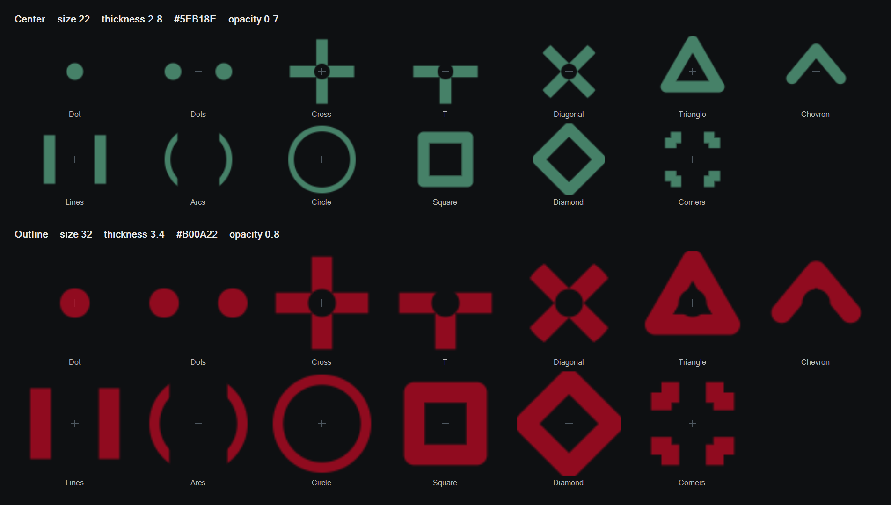

# gtfo-advanced-crosshair

A visor crosshair for GTFO, with melee charge timing, magazine dots, and capacity readouts for packs, items, and tools.

The reticle sits on the visor and sways with it. It is drawn during an expedition while you are in first person.

> While you are running, jumping, falling, reloading, downed, or out of ammo, the center turns white and the outline turns pale green, both at half of their configured opacity. **Static** keeps Center, Outline, and the melee hint at their configured look.

## Features

- Center and outline shapes, each with its own color, size, thickness, and opacity.
- Optional melee charge hint that shrinks onto the crosshair as the swing charges, then changes color and thickens, and hides shortly before the automatic attack.
- Center and outline thicken during that automatic attack, and the outline shifts toward a blink color.
- The crosshair follows recoil that stays on the screen while the camera stays still. Shotgun pellets follow the camera, so that crosshair stays centered.
- Magazine dots beside the outline. A full magazine hides them. Spent rounds stay visible at a lower opacity, and a magazine under five rounds draws one larger dot per round. The dots flash as a reload completes.
- `EMPTY` under the other hints while the wielded gun's magazine has no rounds. A reload that starts empty keeps the word up until that reload finishes.
- Remaining pack capacity, consumable uses, and tool capacity (0 to 100) at the visor center.
- Magazine and reserve ammo below the center while aiming through a magnified scope.

Shapes for Center, Outline, and Hint:

- Dot
- Dots
- Cross
- T
- Diagonal
- Triangle
- Chevron
- Lines
- Arcs
- Circle
- Square
- Diamond
- Corners



By default the reticle is shown for primary, special, and melee weapons, and hidden for tools, packs, and items. Capacity hints use their own toggles, so they can appear while the reticle for that slot is off.

## Requirements

- [GTFO](https://store.steampowered.com/app/493520/GTFO/)
- [BepInEx 6 (Unity IL2CPP)](https://docs.bepinex.dev/) through [r2modman](https://thunderstore.io/c/gtfo/p/ebkr/r2modman/)

## Install

Install [gtfo_advanced_crosshair](https://thunderstore.io/c/gtfo/p/Vyacheslav_921/gtfo_advanced_crosshair/) with r2modman, then launch GTFO with **Play Modded**.

The package places `gtfo-advanced-crosshair.dll` in the profile's `BepInEx\plugins` folder. You can copy that DLL there yourself if you are not using r2modman.

Settings are saved in `BepInEx\config\gtfo-advanced-crosshair.cfg`. Colors are hex `RRGGBB` or `RRGGBBAA`, with no leading `#`. Example: `FF3355`.

## Configuration

### 1 - General

| Setting | Default | What it does |
| --- | --- | --- |
| Crosshair enabled | true | Turns the reticle on. |
| Static | false | Keeps Center, Outline, and the melee hint at their configured look. Disables usage-state colors, the auto-attack blink, and the melee charge animation. |

### Show for:

| Setting | Default | What it does |
| --- | --- | --- |
| Weapons | true | Reticle while holding a primary, special, or melee weapon. |
| Tools | false | Reticle while holding a tool. |
| Packs | false | Reticle while holding a resource pack. |
| Items | false | Reticle while holding a consumable or a carried object. |

### 2 - Center

| Setting | Default | What it does |
| --- | --- | --- |
| Hide when scoped | true | Hides the reticle while aiming through a magnified scope. |
| Follow recoil | true | Moves the reticle with recoil that does not turn the camera. |
| Shape | Arcs | Center shape. Same list as in Features. |
| Color | 5eb18e | Center color. |
| Size | 22 | Center diameter in HUD units. Range 1 to 32. |
| Thickness | 2.8 | Center thickness. For Dot and Dots, this is the dot size. Range 0.5 to 16. |
| Opacity | 0.7 | Center opacity. 0 is invisible, 1 is solid. |
| Auto attack blink color | ff2a2a | Color the outline moves toward just before an automatic melee attack. |
| Auto attack blink thickness increase | 50 | Percent added to Center and Outline thickness during that blink. Range 0 to 200. |

### 3 - Outline

| Setting | Default | What it does |
| --- | --- | --- |
| Shape | Arcs | Outline shape. Same list as in Features. |
| Color | b00a22 | Outline color. |
| Size | 32 | Outline diameter in HUD units. Range 1 to 64. |
| Thickness | 3.4 | Outline thickness. For Dot and Dots, this is the dot size. Range 0.5 to 16. |
| Opacity | 0.8 | Outline opacity. 0 is invisible, 1 is solid. |
| Spacing | 3 | Distance from the center shape. Range 0 to 32. |

### 4 - Hint

| Setting | Default | What it does |
| --- | --- | --- |
| Enabled | true | Melee charge hint. It shrinks to the crosshair, then changes color and thickens, and hides 100 ms before an automatic attack. |
| Show always | false | Keeps the hint visible while no melee attack is charging. |
| Shape | Arcs | Hint shape. Same list as in Features. |
| Color | ffffff | Hint color during the charge. |
| Auto attack color | cb2769 | Hint color as an automatic attack approaches. |
| Auto attack thickness increase | 110 | Percent added to hint thickness as that attack approaches. Range 0 to 200. |
| Size | 78 | Starting diameter of the hint, in HUD units. |
| Thickness | 1.25 | Hint thickness. For Dot and Dots, this is the dot size. Range 0.5 to 16. |
| Opacity | 0.8 | Hint opacity. 0 is invisible, 1 is solid. |

### 5 - Mag counter

Dots to the right of the outline.

| Setting | Default | What it does |
| --- | --- | --- |
| Enabled | true | Shows the magazine dots. |
| Size | 3.2 | Dot diameter in HUD units. Clips shorter than five rounds scale each dot up. Range 1 to 16. |
| Opacity | 0.8 | Opacity of rounds still in the magazine once the dots have faded in. |
| Spent opacity | 0.18 | Opacity of spent rounds once the dots have faded in. |

### 5 - Packs Hints

Remaining uses at the visor center while holding a resource pack.

| Setting | Default | What it does |
| --- | --- | --- |
| Enabled | true | Shows pack capacity. |
| Size | 18 | Text height in HUD units. Range 2 to 48. |
| Opacity | 0.7 | Text opacity. 0 is invisible, 1 is solid. |
| Tool color | 6eccff | Tool refill pack. |
| Medpack color | ff7893 | Health pack. |
| Ammo color | e0d489 | Ammo pack. |
| Disinf color | 87a0e1 | Disinfection pack. |

### 6 - Items Hints

Remaining uses at the visor center while holding a level consumable.

| Setting | Default | What it does |
| --- | --- | --- |
| Enabled | true | Shows the item count. |
| Size | 18 | Text height in HUD units. Range 2 to 48. |
| Opacity | 0.7 | Text opacity. 0 is invisible, 1 is solid. |
| Glow color | 6affeb | Glow stick. |
| Fog color | 93c9c1 | Fog repeller. |
| Foam color | cff8a3 | C-foam grenade. |
| Melter color | ffffff | Melter. |
| Health syringe color | ff7290 | Health syringe. |
| Melee syringe color | 98a607 | Melee syringe. |
| Mine color | f8df81 | Mine. |
| Foam mine color | cff8a3 | C-foam mine. |
| Flashlight color | ede78d | Flashlight. |
| Heavy fog color | ffffff | Heavy fog repeller. |

### 7 - Tools Hints

Remaining class-tool capacity, from 0 to 100 percent of its maximum, at the visor center.

| Setting | Default | What it does |
| --- | --- | --- |
| Enabled | true | Shows tool capacity. |
| Size | 18 | Text height in HUD units. Range 2 to 48. |
| Turret color | ffb15a | Sentry gun. |
| Foam color | 8dffb0 | C-foam launcher. |
| Mine color | f8df81 | Mine deployer. |
| Foam mine color | cff8a3 | C-foam mine deployer. |
| Bio tracker color | 6ecbff | Bio tracker. |

### 8 - Weapon Ammo

Shown below the screen center while aiming through a magnified scope. The upper line is rounds in the magazine. The lower line is reserve ammo.

| Setting | Default | What it does |
| --- | --- | --- |
| Enabled | true | Shows scoped ammo. |
| Margin | 110 | Distance from the screen center to the ammo text. Range 0 to 480. |
| Color | ffffff | Color at a full magazine or a full reserve. |
| Low amount red color hint | true | Shifts each line from Color toward Low color as that ammo pool runs out. |
| Low color | ff2a2a | Color a line reaches when that pool is empty. |
| Size | 18 | Magazine line height in HUD units. Reserve ammo is slightly smaller. Range 2 to 48. |

### 9 - Mag Hint

| Setting | Default | What it does |
| --- | --- | --- |
| Enabled | true | Shows `EMPTY` while the wielded gun's magazine is empty. |
| Size | 18 | Text height in HUD units. Range 2 to 48. |
| Color | ff2a2a | `EMPTY` text color. |
| Shimmer intensity | 0.6 | Gleam on the letters. 0 is a steady color, 1 is the strongest shimmer. |
| Full opacity at | 0.7 | Magazine fill where the dots reach Mag counter opacity. A full magazine always hides the dots. The last 10 rounds always use that opacity. |

## Building

Copy `local.props.example` to `local.props` and set `BepInEx` to your profile's BepInEx folder. That path is only used to compile.

```powershell
dotnet build
```

The plugin is written to `build\gtfo-advanced-crosshair.dll`.

## License

This mod is [MIT](LICENSE) licensed. You may use, change, and share it, including in other mods, as long as the license notice stays with the source.
